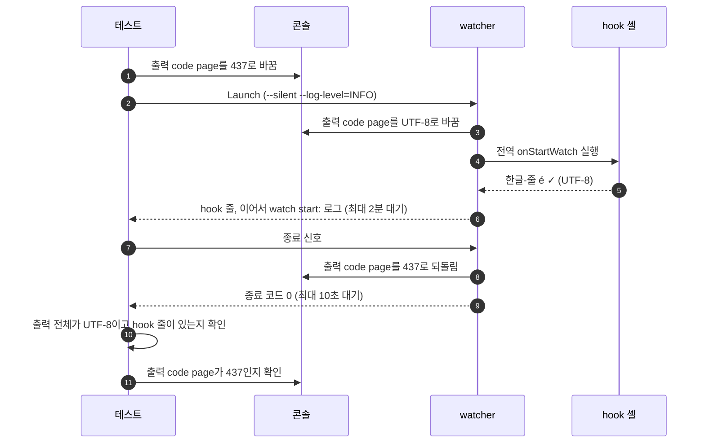

# `TestWindowsShellNonASCIIOutput`: Windows 셸 hook의 비ASCII 출력과 콘솔 출력 code page 복원

🇺🇸 [English](windows-shell-non-ascii-output.md) | 🇰🇷 한국어

- 콘솔 출력 code page가 UTF-8이 아니어도 `cmd`와 Windows PowerShell hook이 출력한 비ASCII 글자가 watcher의 출력에 UTF-8로 그대로 나오는지 확인합니다.

## 확인 내용과 성공 조건

- 테스트는 watcher를 띄우기 전에, 테스트 프로세스와 watcher가 함께 쓰는 콘솔의 출력 code page를 437로 바꿉니다.
  - 437에는 한글과 `✓`가 없으므로, hook 셸이 이 code page로 출력하면 글자가 `?`로 바뀝니다.
  - 하위 테스트가 끝나면 원래 code page로 되돌립니다.
- 전역 `onStartWatch` hook이 `한글-줄 é ✓` 한 줄을 출력합니다.
- watcher가 pipe로 내보낸 stdout과 stderr 전체가 올바른 UTF-8이고, 그 안에 `한글-줄 é ✓` 줄이 그대로 있어야 합니다.
- watcher가 종료 신호를 받고 10초 안에 종료 코드 0으로 끝난 뒤, 콘솔 출력 code page가 437로 돌아와 있어야 합니다.

## 설정

- 전역 `onStartWatch`만 hook을 실행하고, 감시 대상에는 hook이 없습니다.
- watcher는 `--silent`와 `--log-level=INFO`로 실행합니다.
  - `--silent`로 명령 안내 줄을 빼므로, 출력에 있는 `한글-줄 é ✓`는 hook이 출력한 줄입니다.
  - 전역 `onStartWatch`가 끝나야 감시 대상이 시작하므로, `watch start:` 로그가 hook이 끝났다는 표시입니다.
- 테스트는 `watch start:`를 최대 2분 기다립니다. 다른 실행이 같은 VM을 함께 써서 부하가 크면 Windows PowerShell이 hook 줄을 출력하기까지 수십 초가 걸릴 수 있습니다.
- watcher는 실행되는 동안 함께 쓰는 콘솔의 출력 code page를 바꾸므로, 이 테스트는 병렬로 실행하지 않습니다.

## 하위 테스트

- `cmd`는 `echo`로 출력합니다.
- `powershell`은 `Write-Output`으로 출력합니다.

## 진행 순서



## 실행

저장소 루트에서 UTM Windows VM으로 실행하는 명령입니다.

```sh
make e2e-windows ARGS="-- -run '^TestWindowsShellNonASCIIOutput$'"
```

- UTM 명령은 [UTM Windows VM에서 E2E 실행](../windows-utm.ko.md)의 사전 준비를 마치고 `make e2e-windows-up`으로 VM을 켠 뒤 실행합니다.
- `cmd`와 Windows PowerShell은 Windows에서만 지원하는 셸이므로, 이 테스트는 Windows 전용 build tag를 써서 macOS와 Linux에서는 실행되지 않습니다.
- 하위 테스트 하나만 실행하려면 `-run '^TestWindowsShellNonASCIIOutput$/^powershell$'`처럼 지정합니다.

## 관련 코드

- `e2e/scenarios/shell_windows_test.go`에는 `TestWindowsShellNonASCIIOutput`이 있습니다.
- `e2e/harness`: `NewScenario`, `Launch`, `WatcherBin`, `Await`, `Log`, `Stop`. 각 함수의 위치와 책임은 [책임별 코드 위치](../harness.ko.md#책임별-코드-위치)에 있습니다.
- watcher가 콘솔 출력 code page를 바꾸고 되돌리는 코드는 `cmd/console_windows.go`에 있습니다.
