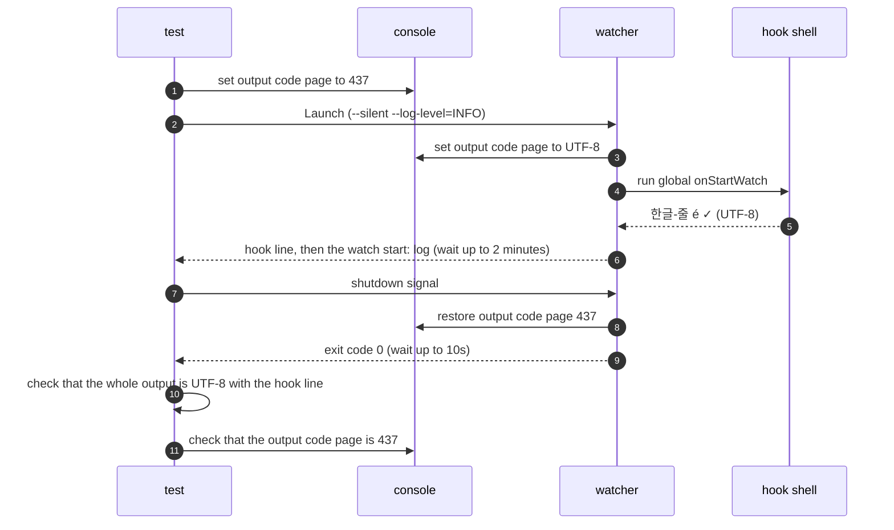

# `TestWindowsShellNonASCIIOutput`: non-ASCII output of Windows shell hooks and console output code page restore

🇺🇸 English | 🇰🇷 [한국어](windows-shell-non-ascii-output.ko.md)

- The test checks that non-ASCII characters printed by `cmd` and Windows PowerShell hooks reach the watcher's output unchanged as UTF-8, even when the console output code page is not UTF-8.

## What it checks and success criteria

- Before launching the watcher, the test sets the output code page of the console shared by the test process and the watcher to 437.
  - Code page 437 has no Korean characters and no `✓`, so a hook shell that prints in this code page turns them into `?`.
  - Each subtest restores the original code page when it ends.
- The global `onStartWatch` hook prints one line, `한글-줄 é ✓`.
- The whole stdout and stderr that the watcher writes to the pipe is valid UTF-8 and contains the line `한글-줄 é ✓` unchanged.
- After the watcher receives the shutdown signal and exits with code 0 within 10 seconds, the console output code page is back to 437.

## Configuration

- Only the global `onStartWatch` runs a hook; the watch target has no hooks.
- The watcher runs with `--silent` and `--log-level=INFO`.
  - `--silent` removes the command announcement lines, so `한글-줄 é ✓` in the output is the line printed by the hook.
  - Watch targets start only after the global `onStartWatch` finishes, so the `watch start:` log marks the end of the hook.
- The test waits up to 2 minutes for `watch start:`. When other runs share the VM and load is high, Windows PowerShell can take tens of seconds to print the hook line.
- The watcher changes the output code page of the shared console while it runs, so this test does not run in parallel.

## Subtests

- `cmd` prints with `echo`.
- `powershell` prints with `Write-Output`.

## Sequence



## Running

Run this command from the repository root on the UTM Windows VM.

```sh
make e2e-windows ARGS="-- -run '^TestWindowsShellNonASCIIOutput$'"
```

- Run the UTM command after completing the prerequisites in [Running E2E on a UTM Windows VM](../windows-utm.md) and starting the VM with `make e2e-windows-up`.
- `cmd` and Windows PowerShell are supported only on Windows, so this test uses a Windows build tag and does not run on macOS or Linux.
- To run a single subtest, specify it as in `-run '^TestWindowsShellNonASCIIOutput$/^powershell$'`.

## Related code

- `e2e/scenarios/shell_windows_test.go` contains `TestWindowsShellNonASCIIOutput`.
- `e2e/harness`: `NewScenario`, `Launch`, `WatcherBin`, `Await`, `Log`, `Stop`. Where each function lives and what it does is in [Code locations by responsibility](../harness.md#code-locations-by-responsibility).
- The code that changes and restores the watcher's console output code page is in `cmd/console_windows.go`.
