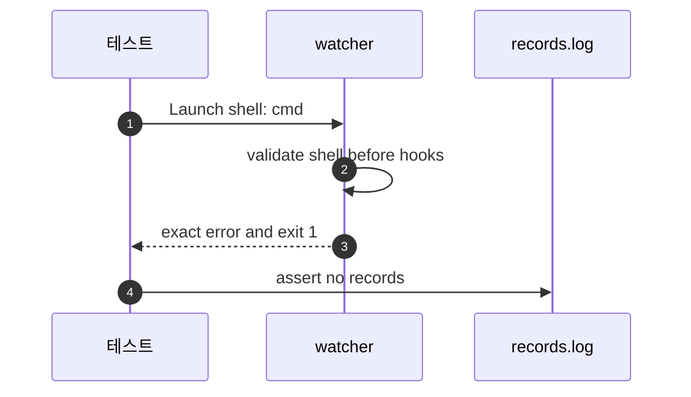

# `TestWindowsShellRejectedOnUnix`: Unix에서 hook 실행 전 cmd 거부

🇺🇸 [English](windows-shell-rejected-on-unix.md) | 🇰🇷 한국어

- Unix에서 `shell: cmd`를 고르면 어떤 hook도 실행하기 전에 실패하는지 확인합니다.

## 확인 내용과 성공 조건

- 프로세스는 10초 안에 종료 코드 1로 끝나야 합니다.
- stdout과 stderr를 합친 출력의 앞뒤 공백을 제거하면 정확히 `Error: shell "cmd" runs only on Windows`여야 합니다.
- 기록 파일이 비어 있어 전역·대상 생명주기 명령이 실행되지 않았어야 합니다.

## 설정

- `shell: cmd`를 지정하고 전역 시작·종료·오류·대기열 경고 hook과 대상 시작·변경·종료 hook 모두에 `hookrec`을 넣습니다.
- [hook 명령을 실행하는 셸](../../../docs/guide/configuration.ko.md#hook-명령을-실행하는-셸)대로 감시 준비 전에 거부되어야 하므로 `Start` 대신 `Launch`를 씁니다.

## 진행 순서



## 실행

- 저장소 루트에서 실행합니다.
- Unix의 셸 거부만 확인하는 Unix 전용 테스트이므로 Windows에서는 실행 대상이 아닙니다.

```sh
go test -count=1 -v -run '^TestWindowsShellRejectedOnUnix$' ./e2e/scenarios
go run ./e2e/linux -- -run '^TestWindowsShellRejectedOnUnix$'
```

## 관련 코드

- `e2e/scenarios/shell_unix_test.go`에 `TestWindowsShellRejectedOnUnix`를 정의합니다.
- 테스트는 `e2e/harness`의 `NewScenario`, `Hook`, `Launch`, `Await`, `Exited`, `ExitErr`, `Log`, `Lines`를 사용합니다.
