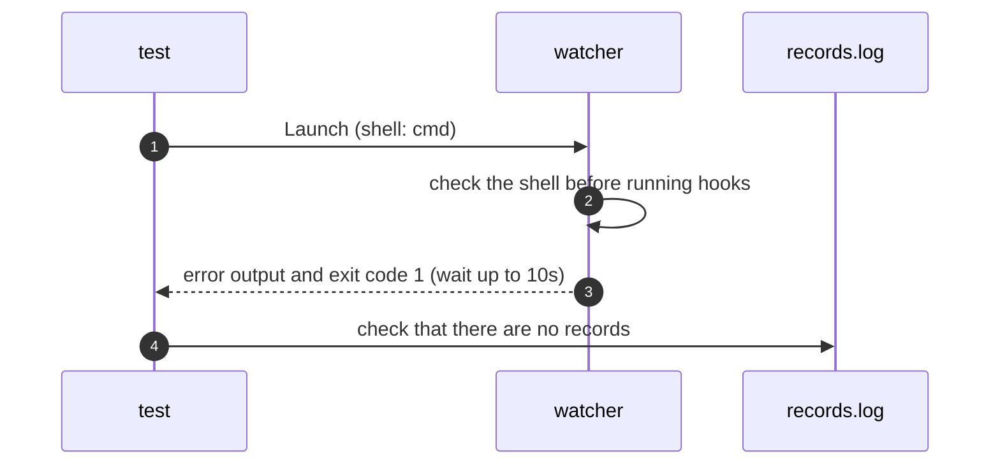

# `TestWindowsShellRejectedOnUnix`: cmd rejection before any hook runs on Unix

🇺🇸 English | 🇰🇷 [한국어](windows-shell-rejected-on-unix.ko.md)

- The test checks that selecting `shell: cmd` on Unix fails before any hook runs.

## What it checks and success criteria

- The process exits within 10 seconds with exit code 1.
- The combined stdout and stderr, after trimming surrounding whitespace, is exactly two lines: `config: <path>` and then `Error: shell "cmd" runs only on Windows`.
  - `<path>` is the path of the `config.yml` in the run folder that `Launch` passes with `-c`.
- The record file remains empty, so neither global nor target lifecycle commands ran.

## Configuration

- `shell: cmd` is set with global start, finish, error, and queue-warning hooks and target start, change, and finish hooks, all pointing to `hookrec`.
- The test uses `Launch` rather than `Start`, because rejection must happen before watch readiness; see [Shell that runs hook commands](../../../docs/guide/configuration.md#shell-that-runs-hook-commands).

## Sequence



## Running

Run these commands from the repository root, locally and in Linux Docker, in that order.

```sh
go test -count=1 -v -run '^TestWindowsShellRejectedOnUnix$' ./e2e/scenarios
go run ./e2e/linux -- -run '^TestWindowsShellRejectedOnUnix$'
```

- This test checks only that Unix rejects `cmd`, so it uses a Unix-only build tag and does not run on Windows.

## Related code

- `e2e/scenarios/shell_unix_test.go` contains `TestWindowsShellRejectedOnUnix`.
- `e2e/harness`: `NewScenario`, `Hook`, `Launch`, `WatcherBin`, `Await`, `Exited`, `ExitErr`, `Log`, `Lines`. Where each function lives and what it does is in [Code locations by responsibility](../harness.md#code-locations-by-responsibility).
